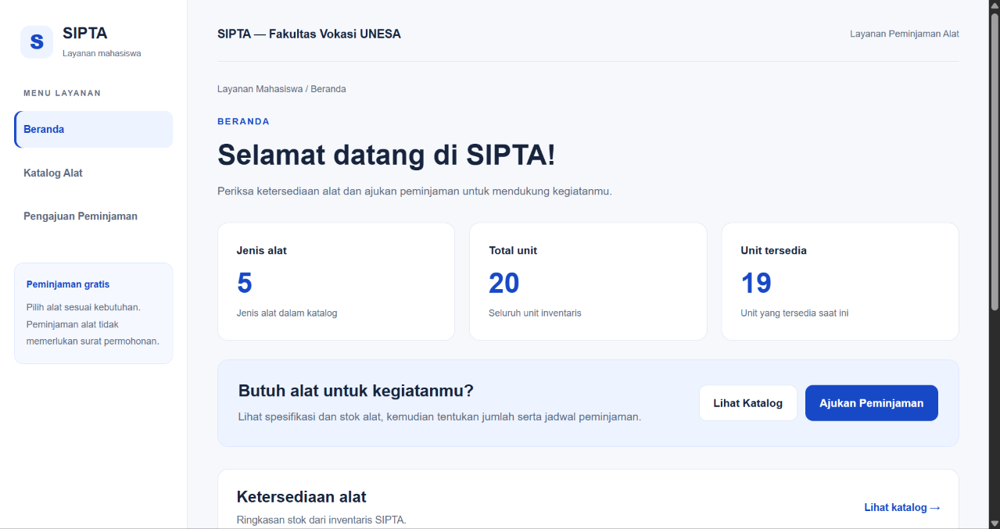
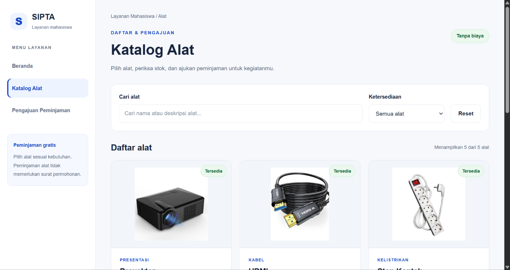
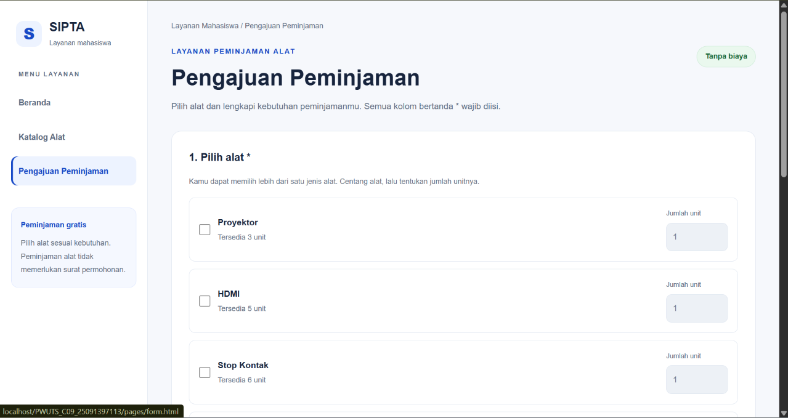

SIPTA — Website Peminjaman Alat

Identitas:
- Nama: Natasya Putri Azahra
- Kelompok: C09
- NIM: 25091397113
- Mata kuliah: Pemrograman Web
- Program studi: D4 Manajemen Informatika

Tentang website
Pada tugas UTS Pemrograman Web ini, saya mengambil bagian peminjaman alat dari proposal kelompok SIPTA, yaitu Sistem Peminjaman dan Sewa Alat dan Ruangan. Saya menggunakan proposal tersebut sebagai acuan untuk tampilan, data alat, dan alur pengajuan peminjaman.

Website ini saya buat untuk memudahkan pengguna melihat alat yang tersedia dan mengisi pengajuan peminjaman. Bagian yang saya kerjakan terdiri dari beranda, katalog alat, dan Pengajuan Peminjaman. Untuk peminjaman alat, pengguna tidak dikenakan biaya dan tidak perlu mengunggah surat permohonan.

Tampilan dan halaman yang saya buat
1. Beranda
Saya membuat beranda dengan tampilan dashboard dan menu di sebelah kiri atau sidebar, mengikuti acuan wireframe pada proposal. Menu yang tersedia adalah Beranda, Katalog Alat, dan Pengajuan Peminjaman.

Pada beranda, saya menampilkan jumlah jenis alat, total unit, unit yang tersedia, dan tabel ketersediaan alat. Angka tersebut diambil dari database, sehingga mengikuti data yang ada di MySQL. Saya juga menambahkan tombol untuk membuka katalog dan pengajuanagar pengguna lebih mudah melanjutkan ke halaman yang dibutuhkan.

2. Katalog alat
Pada halaman katalog, saya menampilkan foto, nama, spesifikasi, kondisi, dan stok alat. Data awal alatnya terdiri dari Proyektor, HDMI, Stop Kontak, Speaker, dan Mic.

Saya menambahkan kolom pencarian agar pengguna dapat mencari alat berdasarkan nama atau deskripsinya. Selain itu, ada filter untuk menampilkan semua alat, alat yang tersedia, atau alat yang stoknya habis. Tombol Reset digunakan untuk mengembalikan pencarian dan filter ke kondisi awal.

Setiap alat yang masih tersedia memiliki tombol Pinjam Alat. Ketika tombol tersebut dipilih, pengguna diarahkan ke pengajuandan alat yang dipilih otomatis tercentang. Jika stoknya habis, tombol peminjaman tidak dapat digunakan.

3. Pengajuan peminjaman
Pada Pengajuan, pengguna dapat memilih lebih dari satu jenis alat dan menentukan jumlah unitnya. Pengguna juga perlu mengisi tanggal pinjam, tanggal rencana kembali, serta keperluan peminjaman.

Di bagian bawah formulir, saya menampilkan ringkasan jumlah jenis alat dan total unit yang dipilih. Untuk biaya, saya menampilkan keterangan Gratis sesuai aturan peminjaman alat pada proposal.

Isian pengajuansaya sesuaikan dengan rancangan tabel peminjaman_alat dan detail_peminjaman_alat. Tanggal dan keperluan merupakan bagian dari data pengajuan, sedangkan ID alat dan jumlah unit merupakan bagian dari detail peminjaman. Namun, penyimpanan pengajuan pada versi ini masih menggunakan sesi PHP.

Beranda - Halaman beranda menampilkan ringkasan dan ketersediaan alat.

[Halaman Beranda]

Katalog Alat - Halaman katalog menampilkan informasi alat, pencarian, dan filter stok.

[Katalog Alat]

Pengajuan Peminjaman - Halaman ini digunakan untuk memilih alat dan mengisi kebutuhan peminjaman.

[Pengajuan Peminjaman]

Penggunaan HTML, CSS, dan JavaScript
Saya menggunakan HTML untuk menyusun halaman, CSS untuk mengatur tampilan, dan JavaScript untuk membuat fitur interaktif. CSS saya pisahkan dalam file style.css agar pengaturan tampilan dapat digunakan oleh semua halaman.

Tampilannya dibuat responsif. Pada layar besar, menu berada di sebelah kiri. Pada layar kecil, menu berpindah ke bagian atas agar isi halaman tetap mudah digunakan. Tabel pada beranda juga dapat digulir ke samping jika ukuran layar tidak cukup lebar.

Untuk navigasi, saya menggunakan teknik Ajax melalui Fetch API. Saat pengguna memilih menu, isi halaman dimuat ke bagian main-content tanpa memuat ulang seluruh halaman. JavaScript juga digunakan untuk menampilkan data alat, menjalankan pencarian dan filter, serta memperbarui ringkasan pada formulir.

Validasi dan proses pengajuan
Sebelum pengajuandikirim, saya menambahkan validasi agar data yang diisi sesuai. Aturannya sebagai berikut:
- Pengguna harus memilih minimal satu alat.
- Jumlah unit harus berupa bilangan bulat, minimal satu, dan tidak melebihi stok tersedia.
- Tanggal pinjam tidak boleh sebelum hari ini.
- Tanggal kembali tidak boleh lebih awal dari tanggal pinjam.
- Keperluan wajib diisi, tidak boleh hanya berisi spasi, dan maksimal 1.000 karakter.
Jika jumlah alat melebihi stok, pengajuanmenampilkan pesan yang menjelaskan batas jumlah yang bisa dipinjam. Jika isian sudah benar, data dikirim melalui metode POST ke process.php.

Di process.php, data diperiksa kembali, termasuk stok terbaru dari database. Jika lolos pemeriksaan, pengajuan disimpan sementara dalam sesi PHP dan diberi kode pengajuan serta status menunggu. Setelah itu, website menampilkan pesan berhasil dan tombol berubah menjadi Pengajuan Terkirim. Status menunggu berarti pengajuan belum disetujui admin.
Penggunaan database

Saya menggunakan database kelompok bernama sipta yang diimpor melalui phpMyAdmin. Database kelompok memiliki tabel untuk seluruh sistem, tetapi pada bagian website yang saya kerjakan, tabel yang digunakan untuk pembacaan data adalah tabel alat.

Tabel tersebut berisi id_alat, nama_alat, deskripsi, jumlah_total, jumlah_tersedia, dan kondisi. File koneksi.php digunakan untuk menghubungkan PHP ke MySQL, sedangkan alat.php membaca data alat dan mengirimkannya dalam format JSON agar bisa ditampilkan oleh JavaScript.

Dengan cara ini, data stok tidak lagi ditulis manual di JavaScript. Jika stok diubah melalui phpMyAdmin, perubahan dapat dilihat setelah halaman dibuka kembali atau dimuat ulang. Foto dan kategori alat masih diatur di alat.php karena belum ada kolom khusus untuk keduanya pada tabel alat.

Perlu diperhatikan bahwa pengajuan baru belum disimpan ke tabel transaksi MySQL. Pengajuan masih berada di $_SESSION['pengajuan_alat'], sehingga penyimpanannya bersifat sementara. Stok juga belum berkurang otomatis setelah pengajuan dikirim, dan pemeriksaannya belum menghitung ketersediaan berdasarkan jadwal peminjaman.

Pembagian file
File atau folder	Kegunaan
index.html	        Halaman beranda dan layout awal website
style.css       	Mengatur tampilan dan penyesuaian ukuran layar
pages/konten.html	Struktur halaman katalog alat
pages/form.html	    Struktur Pengajuan Peminjaman
js/main.js	        Mengatur navigasi Ajax dan tampilan beranda
js/konten.js	    Mengambil data alat serta menjalankan katalog, pencarian, dan filter
js/validasi.js	    Mengatur pilihan alat, validasi, dan pengiriman formulir
koneksi.php	        Menghubungkan website ke database
alat.php	        Mengambil data dari tabel alat
process.php	        Memeriksa dan menyimpan pengajuan sementara
img/	            Menyimpan gambar alat
README.md	        Catatan pengerjaan dan cara menjalankan website

Cara menjalankan website
1. Letakkan folder PWUTS_C09_25091397113 di dalam folder htdocs pada XAMPP. Jika menggunakan lokasi standar Windows, alamatnya adalah C:\xampp\htdocs\PWUTS_C09_25091397113.
2. Buka XAMPP Control Panel, lalu nyalakan Apache dan MySQL.
3. Buka http://localhost/phpmyadmin, lalu impor file SQL kelompok untuk membuat database sipta beserta datanya. Jika database sudah diimpor, langkah ini tidak perlu diulang. Skrip kelompok memiliki perintah penghapusan tabel, jadi menjalankannya ulang dapat menghapus data yang sudah ada.
4. Sesuaikan koneksi pada koneksi.php. Pengaturan lokal yang digunakan adalah host localhost, database sipta, username root, dan password kosong. Jika pengaturan MySQL berbeda, bagian ini perlu disesuaikan.
5. Pastikan gambar alat tersedia di folder img dengan nama yang sesuai pada alat.php.
6. Buka http://localhost/PWUTS_C09_25091397113/index.html melalui browser.

Website perlu dijalankan melalui localhost karena menggunakan PHP dan MySQL. Jika file baru diubah tetapi tampilan belum ikut berubah, tekan Ctrl + F5 untuk memuat ulang. Mengunggah kode ke GitHub tidak otomatis menjalankan PHP dan database; untuk mencoba fitur lengkapnya, proyek tetap perlu dijalankan pada server yang mendukung keduanya.

Pengecekan website
Bagian yang perlu dicek saat mencoba website adalah perpindahan menu, pencarian dan filter katalog, pemilihan alat dari katalog, serta validasi formulir. Pengajuan dengan jumlah melebihi stok harus dicegah, sedangkan pengajuan dengan isian yang benar akan menampilkan kode dan status menunggu.

Untuk mengecek hubungan dengan MySQL, stok alat dapat diubah melalui phpMyAdmin, kemudian katalog dibuka kembali. Angka stok pada website seharusnya mengikuti perubahan tersebut.

Batas pengerjaan
Pada versi ini saya fokus pada beranda, katalog, dan pengajuan peminjaman alat sesuai bagian yang saya ambil. Fitur login, logout, halaman admin, persetujuan, riwayat transaksi, serta pencatatan pengembalian belum dibuat. Fitur ruangan dan pembayaran juga tidak termasuk bagian yang saya kerjakan.

Jadi, MySQL digunakan untuk data alat dan pemeriksaan stok, sedangkan sesi PHP digunakan untuk menyimpan pengajuan sementara. Bagian penyimpanan transaksi ke database dan proses admin masih dapat dikembangkan pada tahap berikutnya.